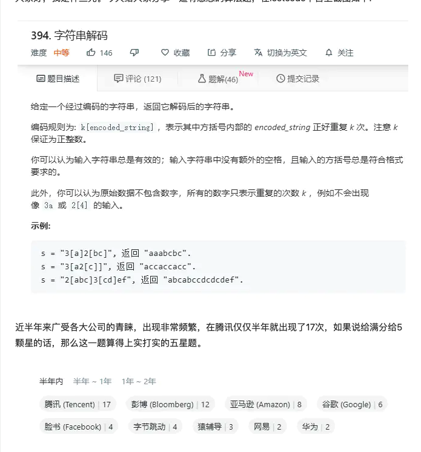

# 394-字符串解码.md

**难度：中等**

[原题](https://juejin.im/post/5dc2a7cce51d4504f0726a00)

> 因为会员才能看到，所以截了个图
> 

这道题一上来就感觉要用正则来匹配，看到文章中写的使用栈，递归啥的，感觉都挺麻烦的

```js
const decodeString = function (s) {
  let stack = [];
  let num = 0; // 1. 当前正在解析的重复次数
  let str = ''; // 2. 当前层已拼接好的字符串
  for (let i = 0; i < s.length; i++) {
    let c = s[i];
    if (c === '[') {
      // 3. 进入下一层前，先把「外层已拼字符串」和「本层次数」暂存到栈，顺序：先 str 后 num
      stack.push(str); // 3.1 外层前缀
      stack.push(num); // 3.2 当前这层的重复次数
      num = 0; // 3.3 重置，供内层解析
      str = '';
    } else if (c === ']') {
      // 4. 一层结束：按与压栈相反的顺序弹出，先 num 后 str
      const repeatNum = stack.pop(); // 4.1 本层次数
      const prevStr = stack.pop(); // 4.2 外层前缀
      str = prevStr + str.repeat(repeatNum); // 4.3 本层字符串重复后，拼到外层前缀后面
      num = 0; // 4.4 本层次数已消费完毕
    } else if (c >= '0' && c <= '9') {
      num = num * 10 + Number(c); // 5. 支持多位数，如 12[a]
    } else {
      str += c; // 6. 普通字母直接累积到当前层
    }
  }
  return str;
};

// 3[a2[c]] -> accaccacc
const result = decodeString('3[a2[c]]');
console.log(result);

const decodeStr = function (s) {
  // 1. 每次只匹配「最内层」的 k[xxx]（括号内无嵌套括号）
  const inner = /(\d+)\[(\w+)\]/;
  // 2. 单次 replace 只能展开一层，嵌套需要反复展开：
  //    3[a2[c]] -> 3[acc] -> accaccacc
  // 3. 用 inner.test 作循环条件：无内层模式时自然退出，也避免非法输入导致死循环
  while (inner.test(s)) {
    s = s.replace(inner, (match, num, str) => str.repeat(Number(num)));
  }
  return s;
};

// 3[a2[c]] -> accaccacc
const result2 = decodeStr('3[a2[c]]');
console.log(result2);

}
```
